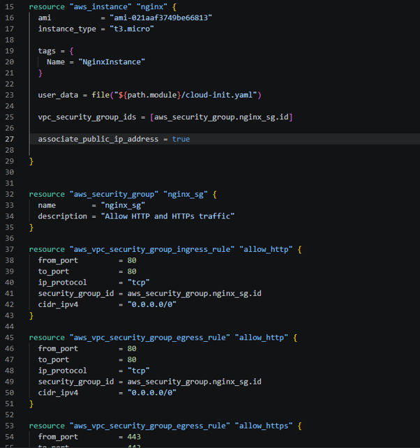

# Terraform EC2 Deployment with Cloud-Init

## Overview

This project uses **Terraform** to provision an AWS EC2 instance and **cloud-init** to configure it automatically as an NGINX web server. The aim of Assignment 2 was to deploy a working webpage with a single `terraform apply`, without manually connecting to the instance to install or configure software.

Terraform creates the AWS infrastructure. Cloud-init, which is available on the Ubuntu cloud image, processes the YAML configuration provided through EC2 user data during boot.

## Architecture

```text
Terraform
  |
  +-- EC2 instance (t3.micro, public IPv4 address)
  |     |
  |     +-- User data: cloud-init.yaml
  |           +-- Update/upgrade packages
  |           +-- Install NGINX
  |           +-- Create /var/www/html/index.html
  |           +-- Enable and start NGINX
  |
  +-- Security group
        +-- Inbound: HTTP (TCP 80) from 0.0.0.0/0
        +-- Outbound: HTTP (TCP 80) and HTTPS (TCP 443)
```

The deployment uses the existing **default VPC** and its networking rather than creating a new VPC, subnet, internet gateway, or route table. The configuration was deployed in **AWS `eu-north-1`**.

## Core Files

| File | Purpose |
| --- | --- |
| `main.tf` | Defines the EC2 instance, security group, and network rules; passes cloud-init through `user_data`. |
| `cloud-init.yaml` | Defines the software installation, webpage creation, and service startup steps. |
| `README.md` | Explains the architecture, workflow, testing, and lessons learned. |



## Cloud-Init Configuration

The configuration uses cloud-init's `#cloud-config` YAML format. The main directives are:

- `package_update` — refreshes the package index.
- `package_upgrade` — upgrades installed packages.
- `package_reboot_if_required` — permits a reboot if an upgrade requires it.
- `packages` — installs NGINX and its dependencies.
- `write_files` — creates the custom HTML entry point at `/var/www/html/index.html` with read access for the web server.
- `defer: true` — writes that file after package installation.
- `runcmd` — makes sure NGINX is enabled and running.


The webpage displays:

> Hello from Terraform & Cloud-init!

In Terraform, the YAML file is passed to EC2 as ordinary text:

```hcl
user_data = file("${path.module}/cloud-init.yaml")
```

There is no need for `user_data_base64` for this plain-text configuration. Terraform passes the file contents to EC2; **cloud-init executes the configuration inside the instance**.

## Deploying

**Prerequisites:** Terraform, AWS credentials configured with the required permissions, an Ubuntu-compatible AMI available in the selected region, and a default VPC with suitable internet routing.

From the project directory:

```bash
terraform init
terraform fmt
terraform validate
terraform plan
terraform apply
```

Review the plan before applying. In this deployment, the plan proposed **5 resources to add, 0 to change, and 0 to destroy**: one EC2 instance, one security group, one inbound HTTP rule, and two outbound rules.

## Testing the Deployment

1. Find the instance's **Public IPv4 address** in the AWS EC2 console.
2. Open `http://<PUBLIC_IP>` in a browser (HTTP, not HTTPS).
3. Check that the custom **Hello from Terraform & Cloud-init!** message appears.

The webpage was successfully served after deployment without manually installing NGINX or editing files on the instance.


If shell access is available, the following commands can help verify the instance configuration:

```bash
cloud-init status --wait
cloud-init status --long
systemctl status nginx
sudo less /var/log/cloud-init-output.log
```

The browser test was completed successfully; a separate cloud-init log/status verification was not recorded as part of the initial test.

## Troubleshooting and Lessons Learned

**The webpage was not available immediately after the first apply.** A subsequent `terraform init` and `terraform apply` returned **no changes**, and the website then became available. Because Terraform made no infrastructure changes on the second apply, the likely explanation is that cloud-init was still updating packages, installing NGINX, or completing startup when the webpage was first tested. This was not independently confirmed from the cloud-init logs.

The key distinction is:

- **Terraform completion** means the requested infrastructure resources have been created or updated.
- **Cloud-init completion** means the instance's startup configuration has finished.
- **Application readiness** means the web server is actually responding to requests.

A successful `terraform apply` does not necessarily prove that cloud-init finished or that the webpage is ready. An HTTP test, service check, or cloud-init status check provides that additional verification.

This project also reinforced Terraform's **implicit dependencies**: referencing `aws_security_group.nginx_sg.id` in the EC2 resource lets Terraform determine that the security group must exist before the instance can use it.

## Cleanup

After capturing any evidence needed for the assignment, remove the infrastructure to avoid ongoing AWS charges:

```bash
terraform plan -destroy
terraform destroy
```

Confirm the resources have been removed in the AWS console. Do not commit Terraform state files, secrets, or the `.terraform/` directory to Git; retain `.terraform.lock.hcl` in version control.

## References

- [Terraform documentation](https://developer.hashicorp.com/terraform/docs)
- [Terraform AWS provider](https://registry.terraform.io/providers/hashicorp/aws/latest/docs)
- [Cloud-init documentation](https://docs.cloud-init.io/)
